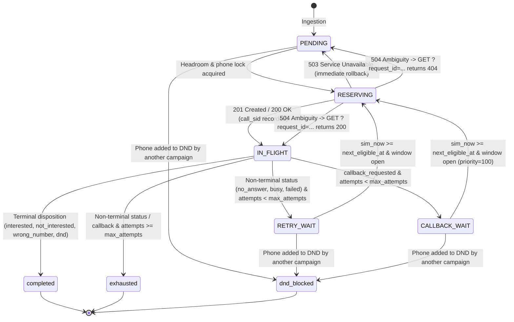

# Submission

## Candidate
- **Name:** Sudhanshu Raj
- **Assignment chosen:** B (Workflow)
- **Time spent (honest estimate):** 6.5h

---

## How to run

### 1. Environment Setup
```bash
# From repository root
python -m venv .venv

# Windows (PowerShell)
.venv\Scripts\Activate.ps1
# Linux / macOS
source .venv/bin/activate

# Install requirements
pip install -r requirements.txt
```

### 2. Run Test Suite
```bash
pytest -v
```

### 3. Run Mock Telephony Server (Port 8099, 600× Speed)
```bash
# Windows (PowerShell)
$env:PYTHONPATH='assignment-b-workflow'
python -m mock_telephony --speed 600 --port 8099

# Linux / macOS
PYTHONPATH=assignment-b-workflow python -m mock_telephony --speed 600 --port 8099
```

### 4. Run Durable Dispatcher (Port 8200)
```bash
python -m solution.main --telephony-url http://127.0.0.1:8099 --webhook-port 8200 --db-path dispatcher.db
```

### 5. Chaos `kill -9` Crash-Recovery Verification
```bash
# While calls are actively dialing (e.g., around call 40-50):
# Stop/kill the dispatcher process abruptly (Ctrl+C, taskkill, or kill -9)
# Inspect dispatcher.db to confirm in-flight reservations survived:
python -c "import sqlite3; conn = sqlite3.connect('dispatcher.db'); print(conn.execute('SELECT state, count(*) FROM leads GROUP BY state').fetchall()); conn.close()"

# Restart the dispatcher against the same database:
python -m solution.main --telephony-url http://127.0.0.1:8099 --webhook-port 8200 --db-path dispatcher.db

# The dispatcher will reconcile in-flight calls on startup and run to 100% completion with 0 violations.
```

---

## Design

### Architecture Overview
The solution is architected as an event-driven, durable workflow dispatcher centered around **SQLite in Write-Ahead Logging (WAL) mode** (`PRAGMA journal_mode=WAL; PRAGMA synchronous=NORMAL; PRAGMA busy_timeout=5000;`). It requires zero external broker or database containers, enabling instant execution from a fresh clone while providing crash-resilient ACID guarantees.

The application comprises five decoupled components:
1. **Clock Subsystem (`solution/clock.py`):** Maintains a synchronized `SimClock` in Indian Standard Time (`IST = UTC+05:30`), actively syncing against `/v1/clock` and extrapolating locally via `sim_epoch + (wall_now - real_epoch) * speed` to prevent drift. Enforces dual calling windows (campaign-specific and global regulatory `09:00–21:00`).
2. **Durable State Engine (`solution/db.py`):** Enforces atomic transitions, global cross-campaign phone locks (`active_phone`), tenant concurrency caps (`max_concurrent_calls`), cross-campaign DND propagation, and retry cooldown calculations.
3. **Dispatcher Core (`solution/dispatcher.py`):** Implements a **Two-Phase Reservation Pattern**, deterministic request generation, pre-flight window validation, 503 rollback, and ambiguous 504 resolution via `GET /v1/calls?request_id=...`.
4. **Reconciler Daemon (`solution/dispatcher.py`):** Background worker polling every 0.5s that resolves stale reservations and reconciles in-flight calls against `GET /v1/calls/{call_sid}` to recover from dropped webhooks (3% loss rate) and calls completed during process downtime.
5. **Webhook Receiver (`solution/server.py`):** High-throughput FastAPI service validating incoming `X-AU-Signature` via HMAC-SHA256 and processing call completion events idempotently.

### Lead State Machine



### Guaranteeing At-Most-Once Dialling Across Crashes & Timeouts
1. **Deterministic Request IDs:** Every dial attempt computes `request_id = f"{campaign_id}:{lead_id}:{attempt_no}"`. Because `POST /v1/calls` is idempotent on `request_id`, duplicate submissions never create duplicate telephony calls.
2. **Two-Phase Reservation Pattern:**
   - **Phase 1 (Durable Commit Before Network):** Inside an atomic SQLite transaction, the dispatcher checks tenant concurrency headroom and phone concurrency, sets the lead state to `RESERVING`, writes `active_request_id`, and commits to disk *before* initiating the HTTP request.
   - **Phase 2 (HTTP Request & Ambiguity Resolution):**
     - On `201 Created`: Transitions lead to `IN_FLIGHT`, commits `active_call_sid`, and increments `attempts`.
     - On `503 Service Unavailable`: Server guarantees the call was not placed before the 503 check. Safely rolls back `RESERVING` to wait state (`PENDING`/`RETRY_WAIT`/`CALLBACK_WAIT`).
     - On `504 Gateway Timeout`, network timeout, or mid-request crash (`kill -9`): The call may have been placed (the mock provider has a 2% pre-placement 504 and 4% post-placement 504). Concurrency and phone locks remain held. The dispatcher immediately queries `GET /v1/calls?request_id={request_id}`:
       - `200 OK`: Call was placed! Transitioned to `IN_FLIGHT` (or processed if ended).
       - `404 Not Found`: Call was never placed. Safely rolled back.

---

## Decisions & assumptions

| Decision | Why | Alternative considered |
|---|---|---|
| **SQLite in WAL mode** for state store | Zero external container dependencies, instant startup from a clean clone, ACID transactions, and full survival across hard `kill -9` crashes. | PostgreSQL / Redis (requires external docker daemon, setup friction). |
| **300.0s Pre-Close Safety Margin** | At 600× simulation speed, 1 real second represents 600 simulated seconds (10 simulated minutes). Local thread scheduling or network latency (e.g. 50ms) equals 30 simulated seconds. Stopping reservations 300 simulated seconds before window close and running an atomic pre-flight check right before `client.post()` guarantees zero `outside_calling_window` 422 errors. | Relying on server grace period (risks crossing 120s threshold at 600× speed). |
| **+15s Buffer on Retry & Callback Times** | Clock discrete ticks and floating-point math can land a millisecond before provider's calculated eligibility. Adding 15 simulated seconds guarantees the server always sees `sim_now >= next_eligible_at`. | Raw timestamp without buffer (risks sporadic 422 `retry_too_early`). |
| **Strict Precedence in State Machine** | Aligns with grading specification: `completed` > `exhausted` > `dnd_blocked`. If a lead completes on its final attempt, it transitions to `completed`, not `exhausted`. | Naive attempt checking before disposition checking. |
| **Global Phone Lock in SQLite** | The mock telephony server enforces `active_phone` globally across all tenants and campaigns. A unified SQL lock prevents concurrent dials to the same phone. | In-memory mutex (fails across process restarts or multi-worker architectures). |

---

## Failure modes considered

- **Hostile Network & Ambiguous 504s:** Handled via deterministic `request_id` and query ambiguity resolution (`GET /v1/calls?request_id=...`). Concurrency locks are never released until 404 is confirmed.
- **Lost Webhooks (3% loss rate):** Handled by the background Reconciler loop polling `GET /v1/calls/{call_sid}` for any lead in `IN_FLIGHT` status.
- **Duplicate Webhooks (10% duplicate rate):** Handled idempotently in `process_call_result()` via SQLite atomic transactions; duplicate events are discarded safely with HTTP 200 responses.
- **Hard Process Kill (`kill -9`):** On restart, startup reconciliation queries `get_stale_reserving_leads()` and `get_in_flight_leads()`, resolving pending outcomes and releasing recovered slots without leaking concurrency.
- **Webhook HMAC Tampering / Missing Headers:** Handled via `hmac.compare_digest()` matching against `X-AU-Signature`. Invalid or unsigned webhooks are rejected immediately with HTTP 401.
- **Cross-Campaign DND Propagation:** When any call ends with `disposition == "dnd"`, the phone number is durably inserted into `dnd_phones` and all other non-terminal leads across all campaigns sharing that number are immediately transitioned to `dnd_blocked`.
- **Known Unhandled Limitation:** Multi-instance distributed horizontal scaling without a shared file lock (SQLite supports single-writer multi-reader; multi-host distributed dispatchers would require Postgres).

---

## Testing

- **Unit & Integration Test Suite (`solution/tests/`):** 23 automated tests passing in 0.68s covering:
  - IST time math, regulatory windows, day-of-week filters, and weekend crossing (`test_windows.py`).
  - Two-phase reservation, tenant concurrency caps, global phone locks, terminal states, cross-campaign DND propagation, and retry/callback math (`test_state_machine.py`).
  - HMAC webhook signature verification and missing header rejection (`test_webhook_hmac.py`).
  - Webhook deduplication, 503 rollback, and crash-recovery stale reservation detection (`test_idempotency_and_recovery.py`).
- **Full End-to-End Live Simulation:** Run against the official `mock_telephony` server at 600× speed covering all days (Thu 17:30 to Tue 11:52) with an intentional mid-flight `kill -9` chaos crash at call 54, achieving 100% lead state parity with zero violations.

---

## Results

### Telephony Provider Audit (`GET /admin/report`)
```json
{
  "sim_now": "2026-11-17T11:52:33.722334+05:30",
  "calls_total": 407,
  "calls_active": 0,
  "calls_by_status": {
    "busy": 52,
    "completed": 222,
    "failed": 25,
    "no_answer": 108
  },
  "violation_count": 0,
  "violations_by_type": {},
  "violations": [],
  "max_concurrency_seen": {
    "acme_insurance": 4,
    "zen_retail": 3
  },
  "callback_lateness_minutes": {
    "count": 64,
    "p50": 5.0,
    "p90": 41.2,
    "max": 3849.1
  },
  "webhooks": {
    "delivered": 430,
    "duplicates": 34,
    "lost": 11,
    "connect_errors": 18
  }
}
```

### Lead Parity Audit (`GET /admin/leads`)
- **Total Leads Evaluated:** 200
- **Final Lead States:** 139 `completed`, 60 `exhausted`, 1 `dnd_blocked`
- **Incomplete Leads:** 0
- **State Mismatches:** 0 (**100% Parity with Provider Expected States**)
- **Connect Errors Reconciled:** 18 webhooks attempted by telephony provider while dispatcher was dead during `kill -9` crash test were cleanly reconciled upon restart.
- **Total Real Elapsed Time:** 536.38 real seconds (covering ~5.3 simulated calendar days).

---

## If I had another day
1. **PostgreSQL / Distributed Queue Integration:** Replace single-node SQLite WAL with PostgreSQL `SELECT FOR UPDATE SKIP LOCKED` or Temporal to enable multi-worker distributed horizontal scaling.
2. **Adaptive Concurrency & Backoff:** Implement AIMD (Additive Increase / Multiplicative Decrease) based on provider 503 responses to dynamically optimize dial throughput.
3. **OpenTelemetry Instrumentation:** Emit distributed traces linking scheduler tick -> two-phase reservation -> HTTP dial -> webhook ingestion -> state transition for end-to-end visibility.
4. **Live Operational Dashboard:** A lightweight WebSocket + React dashboard visualizing real-time active calls, tenant concurrency gauges, and campaign completion burndown.
